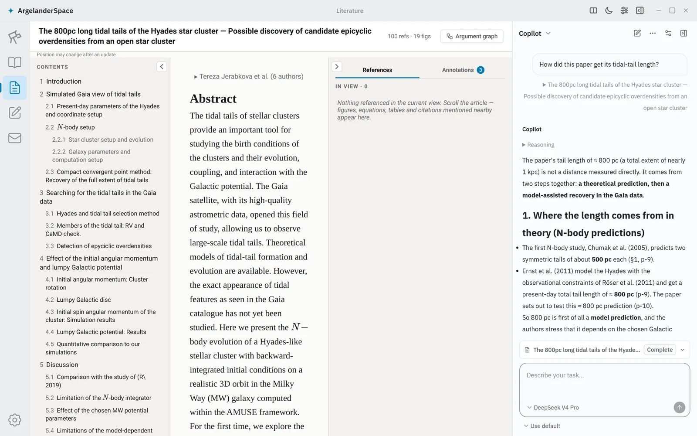
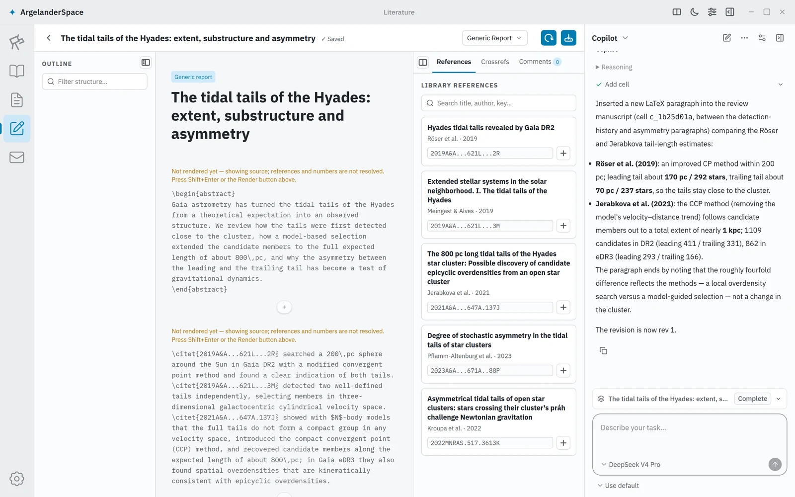
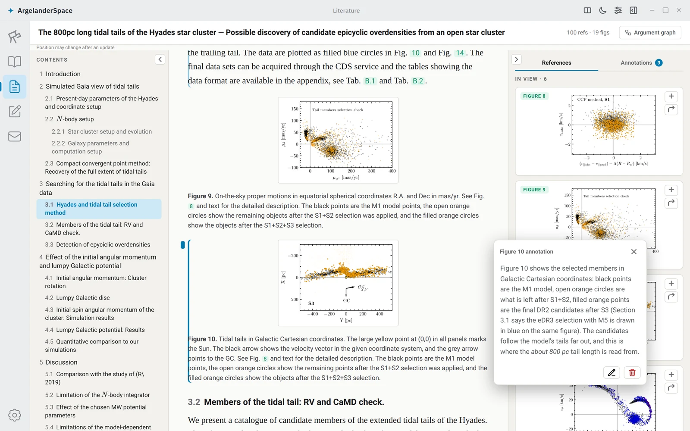
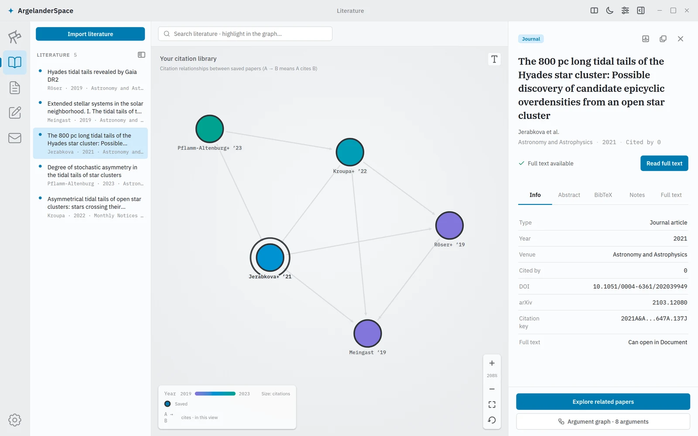
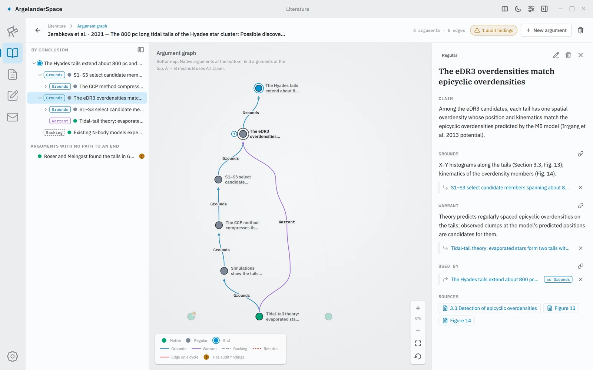
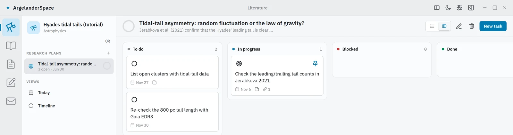

# ArgelanderSpace

**A local research workspace you share with your AI agent.**

Research is scattered across too many tools. ArgelanderSpace brings it into
one app, and gives your AI agent a place in it that shares your working state.

English | [中文](README.zh-CN.md)



A typical project is spread over a PDF reader, a reference manager, a folder
of notes, a to-do app, Overleaf, and a chat window you keep pasting things
into. ArgelanderSpace puts that work in one place on your own computer. The
Copilot works in the same place: it knows what you are reading, what your plan
says and what your draft looks like, so you can ask about "this figure" or
"my introduction" without explaining anything first. Your data stays in your
project folder, apart from what the Copilot sends to the model provider you
choose; there is no telemetry.

## Highlights

### An agent that already knows the context

Asking an AI about your research usually starts with copying: paste the
abstract, describe the figure, paste your draft, then copy the answer back.
Here the Copilot is already in the room. Ask "how did they get this number?"
while you read, and it answers from the paper with links to the passages it
used. Ask it to turn the discussion into a paragraph, and the paragraph appears
in your manuscript; ask it to note a follow-up check, and the task appears on
your plan. It can do what you can do in the interface, so its work lands where
you would have put it yourself, and anything it cannot undo waits for you to
confirm.

If you prefer working from a terminal, Claude Code and other agents reach the
same project through the `argelanderspace` command, with a bundled plugin that
teaches them how to find, read and organize papers. See
[Agent integration](docs/user/agents.md).



### A reader that keeps the context beside the text

Reading a paper means constant page-flipping: to Figure 7 and back, to
equation 12 and back, to the reference list to find out who "Smith et al." is,
and back again. The reader puts that context beside the text instead. The
figures, tables, equations and references a passage mentions appear in the
side panel as you read, so you never lose your place. Your annotations attach
to a sentence, a figure or the whole paper, with Markdown and math, and stay
with the paper rather than inside the file.

Papers with an arXiv source open this way; for other papers the Copilot can
turn the PDF into the same reading form, and the original PDF is always there
to read and annotate as well.



### A library that shows how papers connect

A reference list tells you what you have saved, not how it fits together. The
library draws the citations between your papers, so you can see which ones the
rest build on. When you need more, start from any paper and explore: NASA ADS
suggests similar papers and the references they share, drawn on the same
citation map, and you keep only the ones you want.



### Argument graphs: see how a paper makes its case

A paper's argument is a chain. Observations lead to a measurement; the
measurement and a model lead to an inference; several inferences add up to
the conclusion in the abstract. In the paper, that chain is spread over twenty
pages of prose. An argument graph lays it out on one screen.

Each **argument** is one step of the reasoning, written in the Toulmin form:
the claim it makes, the grounds it rests on, the warrant that connects the
two, and the qualifiers and rebuttals that limit it. Arrows show where one
step's claim is used by the next. With the graph in front of you, you can:

- trace a conclusion back to the evidence and assumptions it really depends on;
- see which steps rest on outside work and which are the paper's own results,
  so you know where to push when you referee it or build on it;
- jump from any step to its passage in the paper;
- let the audit point out circular reasoning and steps that lead nowhere;
- come back to a paper months later and recall it in minutes, without
  rereading it.

Build the graph yourself, or ask the agent to draft it from the paper and then
correct it.



### Plans and writing next to your reading

There is no shortage of to-do apps, and Overleaf works fine. What they don't
have is the rest of your research. Here a task can link to the papers it
needs, so "check their distance estimate" opens the paper in one click. The
Writer cites straight from your library. And because papers, plans and the
manuscript live in one project, the Copilot that just helped you read can
draft the comparison paragraph, add the follow-up task, or tell you what is
left before the deadline. When the draft is ready, take the LaTeX source to
your journal or to Overleaf.



### Also included

Mail (IMAP/SMTP accounts in the app) · a **Shelf** to copy papers, with their
annotations and argument graphs, from one project to another ·
**project intake**, where an agent interviews you to bring a half-finished
project in · an in-app tutorial · English and Chinese interface, light and dark
themes.

## Install

**Desktop app** (recommended): download the package for your system from
[GitHub Releases](https://github.com/HerculeWu/argelanderspace/releases) —
Linux (`.deb`, `.AppImage`), macOS (Apple silicon and Intel, `.dmg`) and
Windows (installer). The app brings its own runtime.

**From source**: Node.js ≥ 24, then

```bash
git clone https://github.com/HerculeWu/argelanderspace.git
cd argelanderspace
corepack pnpm install
corepack pnpm -r build
node packages/app/dist/bin.js serve          # → http://127.0.0.1:1859
```

**TeX** (TeX Live or MiKTeX) is needed only for LaTeX ingest and Writer
rendering, and you install it yourself. Reading PDFs, annotations, plans, Mail
and the Copilot work without it. Details, platform notes (the macOS and Windows
packages are not signed) and optional programs are in
[Installation](docs/user/installation.md).

## Getting started

The quickest way in is the **in-app tutorial**: it opens a sample project
about the tidal tails of the Hyades star cluster and walks you through the
workspace. In the desktop app it starts from the welcome page; from a source
build, run `node packages/app/dist/bin.js tutorial`.

## Status

ArgelanderSpace is pre-release software (0.2). It is a local app for one
person and their agents. It has been tested on Linux; the macOS and Windows
packages are built but not yet tried on real machines. Work on reading now
focuses on PDFs; LaTeX ingest keeps its current abilities. Expect rough edges,
and please [report problems](docs/user/troubleshooting.md).

## Documentation

- [Installation](docs/user/installation.md): requirements, desktop packages,
  running from source
- [Data and configuration](docs/user/configuration.md): the data folder,
  `config.toml`, the ADS token
- [Command line](docs/user/cli.md) and [Agent integration](docs/user/agents.md)
- [LaTeX ingest](docs/user/latex-ingest.md): how a LaTeX source becomes a
  readable document
- [Reporting a problem](docs/user/troubleshooting.md): logs and the
  diagnostics bundle
- [Contributing](CONTRIBUTING.md)

## About the name

Named after Friedrich Wilhelm Argelander, the Bonn astronomer behind the
*Bonner Durchmusterung* star catalogue.

## License

MIT (see `LICENSE`; copyright holder: Wenjie Wu). The screenshots show the
tutorial sample. Its paper is Jerabkova et al. 2021,
[arXiv:2103.12080](https://arxiv.org/abs/2103.12080), licensed
[CC BY 4.0](https://creativecommons.org/licenses/by/4.0/); see
[tutorial-sample/NOTICE.md](tutorial-sample/NOTICE.md).
