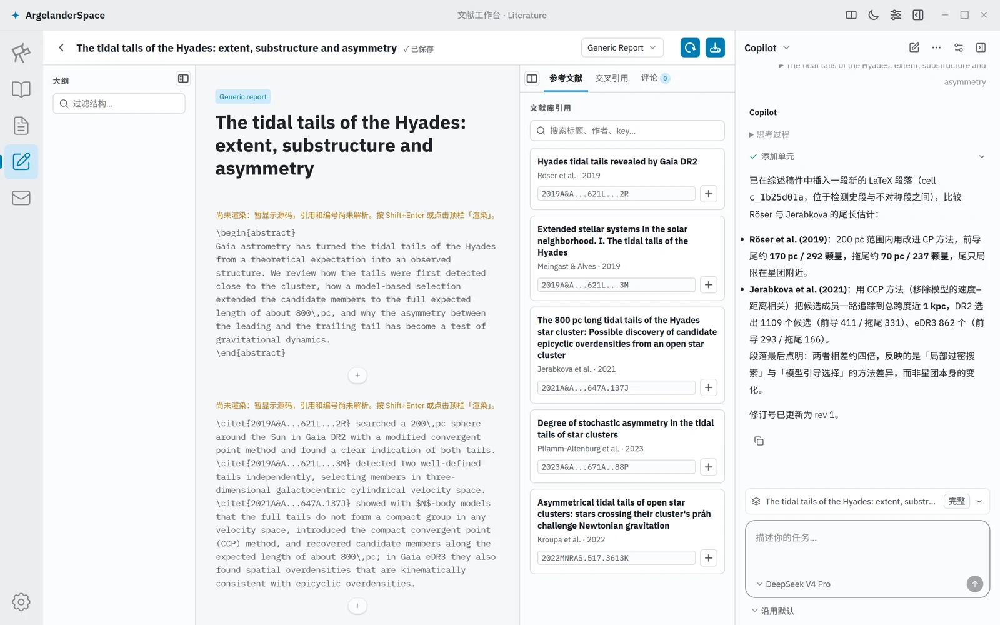
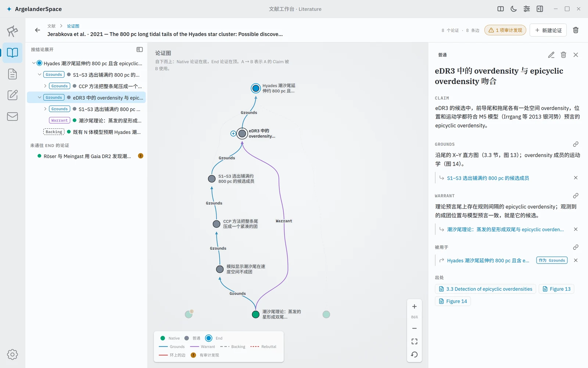
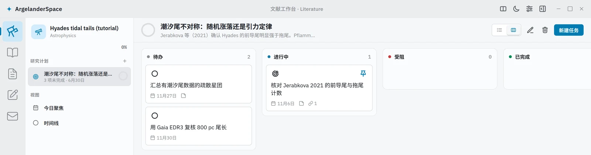

# ArgelanderSpace

**一个你和 AI agent 共用的本地科研工作台。**

科研工作散落在太多工具里。ArgelanderSpace 把它们收进同一个应用，并让你的 AI agent 在其中和你共享工作状态。

[English](README.md) | 中文


一个课题往往分散在 PDF 阅读器、文献管理软件、一堆笔记、待办应用、Overleaf，以及一个你不停往里粘贴内容的聊天窗口之间。ArgelanderSpace 把这些工作放到你自己电脑上的同一个地方。Copilot 也在这里工作：它知道你正在读什么、计划里写了什么、稿子写到了哪儿，所以你可以直接问"这张图"或"我的引言"，不必先解释一遍。数据留在你的项目文件夹里，除了 Copilot 发给你所选模型服务的内容外不外传，也没有遥测。

## 亮点

### 一开口就懂上下文的 agent

和 AI 讨论科研，通常从复制开始：贴摘要、描述图、贴草稿，再把回答复制回去。在这里，Copilot 本来就在现场。读论文时问"这个数是怎么得出来的？"，它根据论文回答，并附上所依据段落的链接。让它把讨论写成一段话，这段话就出现在你的稿件里；让它记下一项后续核查，任务就出现在你的计划上。你在界面上能做的事它也能做，所以它的成果正好落在你自己会放的位置；无法撤回的操作，会先等你确认。

如果你更习惯在终端里工作，Claude Code 等 agent 可以通过 `argelanderspace` 命令进入同一个项目；随附的插件会教它们如何查找、阅读和整理文献。见 [Agent integration](docs/user/agents.md)（英文）。



### 把上下文放在正文旁边的阅读器

读论文意味着不停翻页：翻到图 7 再翻回来，翻到公式 12 再翻回来，翻到参考文献看"Smith et al."是哪篇，再翻回来。这个阅读器把这些上下文放到正文旁边：你读到哪一段，这段提到的图、表、公式和参考文献就出现在侧栏里，你始终不会丢掉阅读位置。标注可以挂在一句话、一张图或整篇论文上，支持 Markdown 和数学公式，它们跟着论文保存，而不是写进文件。

有 arXiv 源码的论文直接以这种方式打开；其他论文可以让 Copilot 把 PDF 转成同样的阅读形式，原始 PDF 也始终可以阅读和标注。


### 看得见文献之间联系的文献库

文献列表只告诉你存了什么，却看不出它们怎样联系在一起。文献库画出你的论文之间的引用关系，让你看清哪些是其他工作的基础。需要更多文献时，从任意一篇出发去探索：NASA ADS 会推荐相似的论文以及它们共同引用的文献，画在同一张引用图上，你只保留想要的。


### 论证图：看清一篇论文如何论证

一篇论文的论证是一条链：观测得出测量结果，测量结果加上模型得出推断，几项推断合起来才是摘要里的结论。在论文里，这条链分散在二十页文字中；论证图把它摆在一屏之内。

每个**论证**是推理中的一步，按 Toulmin 模型记录：它提出的主张（Claim）、所依据的事实（Grounds）、把两者联系起来的理由（Warrant），以及限定它的条件（Qualifier）和例外（Rebuttal）。箭头表示一步的主张被下一步所用。有了这张图，你可以：

- 从结论倒推回它真正依赖的证据和假设；
- 看出哪些步骤依赖外部工作、哪些是论文自己的结果，审稿或在其基础上做研究时，知道该从哪里追问；
- 从任何一步跳到它在原文中的位置；
- 让审计指出循环论证和通向不了结论的步骤；
- 几个月后重新拿起一篇论文，几分钟就能回想起来，不用重读。

可以自己整理论证图，也可以让 agent 根据论文起草，再由你修改。



### 计划与写作，就在阅读旁边

待办应用并不缺，Overleaf 也很好用。它们缺的是你研究中的其余部分。在这里，任务可以链接到它需要的论文，点一下"核对他们的距离估计"就能打开那篇论文。Writer 直接从你的文献库插入引用。而且因为论文、计划和稿件都在同一个项目里，刚刚帮你读完论文的 Copilot 可以起草对比段落、添加后续任务，或者告诉你截止日期前还剩什么。稿子写好后，把 LaTeX 源码带去投稿或交给 Overleaf。



### 还有

邮件（在应用里收发 IMAP/SMTP 邮件）· **文献仓**：把论文连同标注、论证图从一个项目复制到另一个项目 · **项目迁入**：agent 像访谈一样问你，把做到一半的项目带进来 · 应用内教程 · 中英文界面，浅色与深色主题。

## 安装

**桌面应用**（推荐）：从 [GitHub Releases](https://github.com/HerculeWu/argelanderspace/releases) 下载对应系统的安装包，包括 Linux（`.deb`、`.AppImage`）、macOS（Apple 芯片与 Intel，`.dmg`）和 Windows（安装程序）。应用自带运行环境。

**从源码运行**：需要 Node.js ≥ 24，然后

```bash
git clone https://github.com/HerculeWu/argelanderspace.git
cd argelanderspace
corepack pnpm install
corepack pnpm -r build
node packages/app/dist/bin.js serve          # → http://127.0.0.1:1859
```

**TeX**（TeX Live 或 MiKTeX）只有 LaTeX 摄入和 Writer 渲染需要，需自行安装；阅读 PDF、标注、计划、邮件和 Copilot 不需要它。详细要求、各平台说明（macOS 与 Windows 安装包未签名）和可选程序见 [Installation](docs/user/installation.md)（英文）。

## 上手

最快的方式是**应用内教程**：它打开一个关于毕星团（Hyades）潮汐尾的示例项目，带你走一遍工作台。桌面应用在欢迎页启动教程；从源码运行时执行 `node packages/app/dist/bin.js tutorial`。

## 现状

ArgelanderSpace 仍是预发布版本（0.2），是给一个人和他们的 agent 用的本地应用。目前在 Linux 上测试过；macOS 与 Windows 安装包已经构建，但还没在真机上试过。阅读方面的开发现在以 PDF 为主，LaTeX 摄入保持现有能力。难免有粗糙之处，欢迎[报告问题](docs/user/troubleshooting.md)。

## 文档

以下文档为英文：

- [Installation](docs/user/installation.md)：要求、桌面安装包、从源码运行
- [Data and configuration](docs/user/configuration.md)：数据文件夹、`config.toml`、ADS token
- [Command line](docs/user/cli.md) 与 [Agent integration](docs/user/agents.md)
- [LaTeX ingest](docs/user/latex-ingest.md)：LaTeX 源码如何变成可读文档
- [Reporting a problem](docs/user/troubleshooting.md)：日志与诊断包
- [Contributing](CONTRIBUTING.md)

## 名字的由来

取自 Friedrich Wilhelm Argelander，波恩天文学家，《波恩星表》（*Bonner Durchmusterung*）的主持者。

## 许可

MIT（见 `LICENSE`；版权人：Wenjie Wu）。截图来自教程示例，其中的论文是 Jerabkova et al. 2021，[arXiv:2103.12080](https://arxiv.org/abs/2103.12080)，许可为 [CC BY 4.0](https://creativecommons.org/licenses/by/4.0/)；见 [tutorial-sample/NOTICE.md](tutorial-sample/NOTICE.md)。
