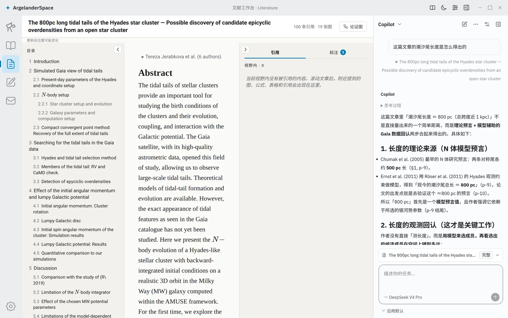
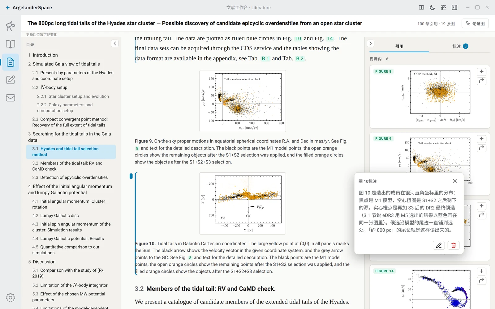
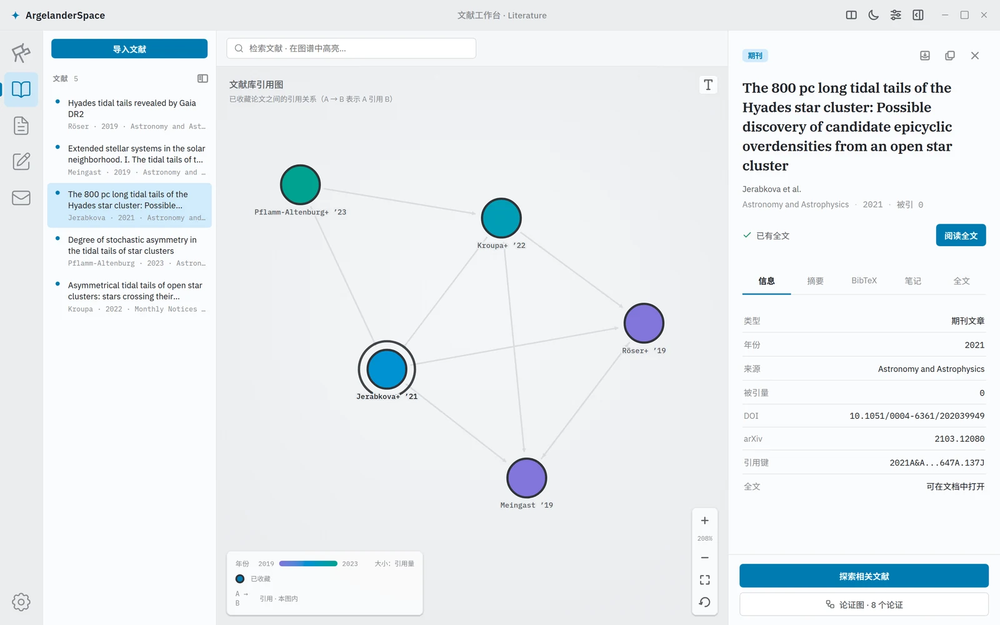

# ArgelanderSpace

**面向科研人员与 AI Agent 的本地工作台。**

科研工作往往分散在太多工具之间。ArgelanderSpace 将文献、笔记、计划与写作整合进单一工作空间，并让 AI Agent 共享当前的研究上下文。

[English](README.md) | 中文



一项典型的课题研究往往割裂在多处：PDF 阅读器、文献管理软件、散落的笔记、待办清单、Overleaf，以及一个反复被投喂内容的聊天窗口。ArgelanderSpace 将这些工作流汇聚于本地设备。内置 Copilot 与研究环境完全同频：它知晓当前正在阅读的段落、研究计划的安排以及正在撰写的手稿，无需每次提问前重复交代背景，即可直接讨论“这张图”或“引言部分”。所有数据均保存在本地项目目录中，除发往指定模型供应商的请求外，不上传任何内容，无遥测数据追踪。

## 核心特性

### 深度理解研究上下文的智能体

向常规 AI 提问科研问题往往始于繁琐的复制粘贴：摘要、图表说明、论文草稿，最后再把生成的回答粘回手稿。而在 ArgelanderSpace 中，Copilot 始终处于工作现场。在阅读论文时随口询问“这个数值是如何推导的？”，它便会结合原文作答，并附带引用段落的定位跳转链接。让它将一段讨论整理成文字，段落便会直接插入手稿；让它记录一项待办核查，任务就会即刻归入计划看板。界面中人工可执行的操作，Agent 同样可以调用，生成结果均会自动落在对应的工作模块中；不可撤销的操作则会先行等待人工确认。

对于偏好终端操作的用户，通过 `argelanderspace` 命令行即可让 Claude Code 等外部 Agent 接入同一项目；随附插件赋予了它们检索、阅读与整理文献的能力。详情参见 [Agent 集成文档](docs/user/agents.md)（英文）。


### 上下文紧贴正文的沉浸式阅读器

读文献常伴随着频繁的前后翻页：为了对照图 7、核查公式 12，或是翻到文末确认“Smith et al.”到底出自何处。该阅读器将这类依赖信息直接锚定在正文侧栏：阅读特定段落时，文中引用的图表、公式及参考文献会同步呈现在旁侧，避免打断阅读思路。标注支持挂载于单句、图表或全篇，兼容 Markdown 与数学公式，且批注元数据直接关联文献本身，无需污染原始文件。

带有 arXiv 源的论文可直接以该排版模式打开；普通 PDF 亦支持经 Copilot 结构化转换后以相同形式呈现，原始 PDF 及其原生批注功能始终保留。



### 呈现学术脉络的关联文献库

传统的文献列表仅能罗列已存条目，难以展现论文间的承继关系。该文献库能自动梳理并绘制论文间的引用网络，清晰呈现哪些文献构成了后续工作的基础。需要拓展视野时，以任意文献为起点即可展开探索：NASA ADS 会推荐关联论文及共同引用的文献，并在同一张引用图谱中动态展开，便于筛选收录。



### 论证结构图：透视论文的推演逻辑

学术论文的论述本质上是一条严密的逻辑链条：从观测提炼测量值，由测量结合模型得出推论，多项推论最终归纳为摘要中的核心结论。在常规论文中，这条逻辑链散落在数十页文本之间；而论证图则将其浓缩于单屏呈现。

每个**论证节点**代表推演中的一步，遵循 Toulmin 论证模型构建：包括提出的主张（Claim）、支撑主张的事实依据（Grounds）、连接两者的理由（Warrant），以及限定范围（Qualifier）与反例辨析（Rebuttal）。节点间的连线箭头清晰标明了前序结论如何被后序步骤引用。借助论证图，可以实现：

- 顺藤摸瓜：将结论逆向回溯至其最基础的原始数据与假设；
- 明确边界：分清哪些步骤依赖前人工作、哪些是本论文的核心创新，从而在审稿或跟进研究时精准把握切入点；
- 双向锚定：从任意逻辑节点一键跳转至论文原文出处；
- 逻辑审计：自动识别循环论证或缺乏支撑的断言；
- 高效复盘：数月后重新回顾一篇长文，数分钟内即可理清核心脉络，无需通读全文。

论证图既支持手动梳理，也可交由 Agent 提炼初稿后再行校准。


### 围绕阅读展开的计划与写作

市面上不乏待办工具与排版软件（如 Overleaf），但它们往往脱离了研究资产本身。在 ArgelanderSpace 中，计划任务可直接关联文献，点击“核对距离估算”即可瞬间调出对应论文；写作模块（Writer）支持直接从文献库检索并插入引用。由于文献、待办任务与写作手稿共存于同一工程下，协助读完文献的 Copilot 能无缝起草对比段落、追加后续验证任务，或是梳理截稿前未竟的事项。成稿之后，可随时导出标准 LaTeX 源码以供投稿或同步至 Overleaf。


### 更多内置功能

内置邮件客户端（支持在应用内配置 IMAP/SMTP 账户）· **文献架（Shelf）**：跨项目迁移文献及其批注与论证图 · **项目导入访谈**：由 Agent 引导对话，无痛导入进行到一半的研究项目 · 应用内上手引导 · 中英文双语界面，适配浅色与深色主题。

## 安装指南

**桌面客户端**（推荐）：前往 [GitHub Releases](https://github.com/HerculeWu/argelanderspace/releases) 获取适配各平台的安装包：
- Linux：`.deb`、`.AppImage`
- macOS：适配 Apple Silicon 与 Intel 架构的 `.dmg`
- Windows：安装程序

安装包自带内置运行时环境。

**从源码构建**：需提前安装 Node.js ≥ 24，随后执行：

```bash
git clone https://github.com/HerculeWu/argelanderspace.git
cd argelanderspace
corepack pnpm install
corepack pnpm -r build
node packages/app/dist/bin.js serve          # 服务启动后访问 http://127.0.0.1:1859
```

**TeX 环境**（TeX Live 或 MiKTeX）：仅在解析原生 LaTeX 源码及 Writer 编译渲染时需要，需手动安装。日常的 PDF 阅读、批注、计划管理、邮件收发及 Copilot 交互无需依赖 TeX 环境。详细运行要求、平台差异说明（macOS 与 Windows 安装包目前暂未进行代码签名）及可选依赖项见 [安装指南](docs/user/installation.md)（英文）。

## 快速上手

建议通过**应用内上手引导**体验工作流：该教程内置了一个关于毕星团（Hyades）潮汐尾研究的示例项目，可循序渐进地熟悉工作台功能。在桌面端可直接从欢迎页启动；若使用源码部署，运行 `node packages/app/dist/bin.js tutorial` 即可。

## 项目现状

ArgelanderSpace 目前处于预览阶段（0.2 版本），定位为单人配合自主 Agent 协作的本地化软件。目前已在 Linux 环境完成充分测试；macOS 与 Windows 安装包已完成构建产出，尚待更广泛的真机验证。文献阅读板块目前优先打磨 PDF 体验，LaTeX 源码解析功能维持现有支持度。软件尚处于积极迭代期，难免存在粗糙之处，欢迎随时[提交反馈与缺陷](docs/user/troubleshooting.md)。

## 延伸文档

下列补充文档目前仅提供英文版本：

- [安装指南 (Installation)](docs/user/installation.md)：系统要求、二进制分发包与源码编译
- [数据与环境配置 (Data and configuration)](docs/user/configuration.md)：数据目录布局、`config.toml` 配置项、ADS API 凭证
- [命令行工具 (CLI)](docs/user/cli.md) 与 [Agent 集成指南 (Agent integration)](docs/user/agents.md)
- [LaTeX 解析机制 (LaTeX ingest)](docs/user/latex-ingest.md)：LaTeX 源码转为交互文档的实现机制
- [问题排查与反馈 (Reporting a problem)](docs/user/troubleshooting.md)：日志收集与诊断包导出
- [贡献指南 (Contributing)](CONTRIBUTING.md)

## 命名渊源

本项目以 19 世纪波恩天文台天文学家弗里德里希·威廉·奥古斯特·阿格兰德（Friedrich Wilhelm Argelander）命名，以致敬其主导编纂的近代天文学里程碑著作《波恩星表》（*Bonner Durchmusterung*）。

## 开源协议

基于 MIT 协议分发（详见 `LICENSE`；版权所有：Wenjie Wu）。界面演示截图取自教程示例项目，所涉论文为 Jerabkova 等人于 2021 年发表的 [arXiv:2103.12080](https://arxiv.org/abs/2103.12080)，遵循 [CC BY 4.0](https://creativecommons.org/licenses/by/4.0/) 协议分发；详情参见 [tutorial-sample/NOTICE.md](tutorial-sample/NOTICE.md)。